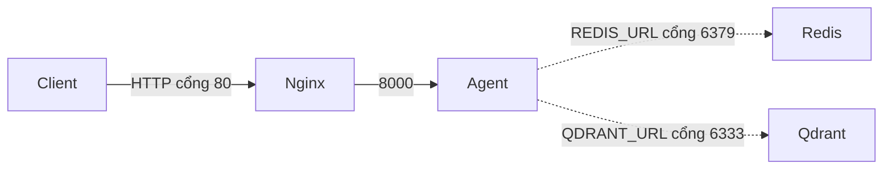

# Day 14 — Mission Answers

## Checkpoint và file cần hoàn thiện

| Mốc | Việc cần làm | Nơi ghi kết quả |
| --- | --- | --- |
| CP0 · Setup | Xác nhận tên bản fork, Python 3.11+ trên Linux/WSL2 và Docker Compose | Mục Setup bên dưới |
| CP1 · Localhost vs Production | Chạy mẫu, gọi `/ask`, đối chiếu config, probe, log và shutdown | Part 1 |
| CP2 · Docker | Build hai Dockerfile từ gốc repo, đo dung lượng, chạy stack qua Nginx | Part 2 |
| CP3 · API Security | Thử API key, lấy JWT, vượt giới hạn lab, phân tích budget | Part 4 |
| CP4 · Scaling & Reliability | Quan sát probe và SIGTERM, chạy `test_stateless.py` với 3 agent sau Nginx | Part 5 |
| CP5 · Final Project | Hoàn thiện agent trong `06-lab-complete/` và chạy bộ chấm đủ 12 tiêu chí | Part 6 và [hướng dẫn chạy](06-lab-complete/README.md) |

Thứ tự CP theo [CHECKPOINTS.md](CHECKPOINTS.md). Yêu cầu bằng chứng theo [SUBMISSION.md](SUBMISSION.md) và [RUBRIC.md](RUBRIC.md).

CP0–CP5 đã xác minh tại máy. Cấu hình Render Blueprint của agent sẵn sàng cho bước triển khai CP6.

### CP0 — Setup

Working copy và remote `origin` có tên theo mẫu nhóm L3B, nhánh làm việc là `main`. Docker Desktop chạy Linux engine trên WSL2 và đã chạy thành công `docker run --rm hello-world`. Dùng Python 3.11 trong container Linux để chạy bài lab trên máy Windows.

## Part 1 — Localhost vs Production

### Exercise 1.1 — Anti-patterns

1. API key và chuỗi kết nối chứa mật khẩu được nhúng trong mã nguồn. Mỗi bản sao repo hoặc image đều có thể mang theo giá trị. [develop/app.py dòng 17](01-localhost-vs-production/develop/app.py#L17)
2. `DEBUG` và giới hạn token là hằng số. Muốn thay đổi theo môi trường phải sửa code. [develop/app.py dòng 21](01-localhost-vs-production/develop/app.py#L21)
3. `print()` đưa cả câu hỏi, câu trả lời và key vào log. Log cũng thiếu field để lọc theo sự kiện. [develop/app.py dòng 33](01-localhost-vs-production/develop/app.py#L33)
4. Bản develop thiếu health endpoint để nền tảng kiểm tra tiến trình. [develop/app.py dòng 42](01-localhost-vs-production/develop/app.py#L42)
5. Bind vào loopback và cố định cổng 8000. Proxy ngoài container cần ứng dụng lắng nghe trên mạng container và dùng cổng nền tảng cấp. [develop/app.py dòng 51](01-localhost-vs-production/develop/app.py#L51)
6. Bật reload theo thay đổi mã nguồn và thiếu bước dọn tài nguyên qua lifespan. Reload phù hợp vòng lặp phát triển, còn deploy cần quản lý vòng đời của process rõ ràng. [develop/app.py dòng 47](01-localhost-vs-production/develop/app.py#L47)

### Exercise 1.2–1.3 — Chạy thử và so sánh

Lệnh bản develop là `curl -i -X POST "http://localhost:8000/ask?question=Hello"`. Kết quả trong runner Linux:

```text
HTTP/1.1 200 OK
content-type: application/json

{"answer":"Tôi là AI agent được deploy lên cloud. Câu hỏi của bạn đã được nhận."}
```

Bản production trả `HTTP/1.1 200 OK` với `"status":"ok"` ở `GET /health`.

| Hạng mục | Develop | Production | Vì sao quan trọng |
| --- | --- | --- | --- |
| Config | Hằng số trong `app.py` | `Settings` đọc env, xác thực key ở production | Cùng image chạy được ở nhiều môi trường. [production/config.py](01-localhost-vs-production/production/config.py#L15) |
| Health check | Chỉ có route chức năng | Có `/health` và `/ready` | Phân biệt process còn sống và instance có thể nhận traffic. [production/app.py](01-localhost-vs-production/production/app.py#L135) |
| Logging | `print()` cả key | Sự kiện request/response ghi JSON qua `logging` | Tìm sự kiện theo field và tránh ghi key vào log request. [production/app.py](01-localhost-vs-production/production/app.py#L102) |
| Shutdown | Thiếu cleanup qua lifespan | Lifespan có pha shutdown, Uvicorn quản lý request đang xử lý | Agent có thời gian hoàn tất request và dọn tài nguyên. [production/app.py](01-localhost-vs-production/production/app.py#L40) |

## Part 2 — Docker

### Exercise 2.1 — Dockerfile

1. Base image là `python:3.11`.
2. Working directory là `/app`.
3. Copy `requirements.txt` trước mã nguồn để tái sử dụng layer cài dependency khi chỉ sửa code.
4. `ENTRYPOINT` xác định chương trình chính. `CMD` là lệnh mặc định hoặc tham số mặc định truyền cho `ENTRYPOINT`; đối số của `docker run IMAGE ...` thay được `CMD`. Mẫu dùng `CMD ["python", "app.py"]`.

### Exercise 2.2–2.3 — Kích thước và chạy image

Stage builder cài công cụ biên dịch và Python packages. Stage runtime dùng base slim và chỉ lấy các packages đã cài cùng source. Số đo từ Docker Engine 29.9.3:

| Image | Disk usage từ `docker images` | `docker image inspect` (byte) |
| --- | ---: | ---: |
| `my-agent:develop` | 1.67 GB | 1,667,788,062 |
| `my-agent:advanced` | 240 MB | 239,815,419 |

Image advanced giảm **85.62%** theo công thức `(develop - production) / develop * 100` trên số byte. Bản develop được map sang cổng 18000 ở host vì cổng 8000 đã có tiến trình sử dụng.

```text
POST /ask?question=What%20is%20Docker%3F
HTTP/1.1 200 OK
content-type: application/json

{"answer":"Container là cách đóng gói app để chạy ở mọi nơi. Build once, run anywhere!"}
```

### Exercise 2.4 — Stack



Nginx là cổng vào. Redis và Qdrant nằm trên mạng Compose nội bộ. Compose chờ health check của cả hai trước khi khởi động agent. Các kết nối có nét đứt là cấu hình dependency, còn `/ask` mẫu gọi mock LLM.

```text
GET http://127.0.0.1/health
HTTP/1.1 200 OK
Server: nginx

{"status":"ok","uptime_seconds":3.4,"version":"2.0.0","timestamp":"2026-11-26T07:38:30.721090"}

POST http://127.0.0.1/ask {"question":"Explain microservices"}
HTTP/1.1 200 OK
Server: nginx

{"answer":"Agent đang hoạt động tốt! (mock response) Hỏi thêm câu hỏi đi nhé."}
```

## Part 4 — API Security

### Exercise 4.1–4.3 — API key, JWT, rate limit

- Bản develop đọc `X-API-Key` bằng dependency `verify_api_key`. Thiếu key trả 401, key sai trả 403. Để rotate key, cập nhật `AGENT_API_KEY` ở môi trường chạy, restart service và cập nhật các client. Agent Part 6 dùng 401 cho cả hai trường hợp theo hợp đồng riêng.
- Bản production cấp JWT tại `POST /auth/token` khi thông tin đăng nhập hợp lệ. Client gửi `Authorization: Bearer …`. Server xác minh chữ ký, thời hạn và đọc role từ token đã xác minh.
- Ví dụ production dùng deque timestamp theo username cho sliding window 60 giây. Role thường có 10 request/phút, admin có quota 100 request/phút. Muốn bỏ giới hạn cho admin cần nhánh chính sách riêng sau khi xác thực role phía server. Part 6 chuyển cửa sổ sang Redis để mọi worker dùng chung state.

Trích output `curl -i` trong lượt chạy local. Key và token được giữ trong biến của phiên chạy.

```text
# Develop /ask, thiếu key
HTTP/1.1 401 Unauthorized
content-type: application/json

{"detail":"Missing API key. Include header: X-API-Key: <your-key>"}

# Develop /ask, key đúng
HTTP/1.1 200 OK
content-type: application/json

{"question":"Hello","answer":"Đây là câu trả lời từ AI agent (mock). Trong production, đây sẽ là response từ OpenAI/Anthropic."}

# Production /ask, JWT hợp lệ, request thứ 1
HTTP/1.1 200 OK
content-type: application/json

{"question":"Hello","answer":"Agent đang hoạt động tốt! (mock response) Hỏi thêm câu hỏi đi nhé.","usage":{"requests_remaining":9,"budget_remaining_usd":1.6e-05}}

# Production /ask, JWT hợp lệ, request thứ 11
HTTP/1.1 429 Too Many Requests
x-ratelimit-limit: 10
x-ratelimit-remaining: 0
retry-after: 59
content-type: application/json

{"detail":{"error":"Rate limit exceeded","limit":10,"window_seconds":60,"retry_after_seconds":59}}
```

### Exercise 4.4 — Cost guard

Với ví dụ 10 USD/tháng theo user, dùng Redis key gồm ID người dùng đã xác thực và tháng UTC. Kiểm tra `chi phí hiện tại + chi phí dự kiến`, cập nhật và đặt TTL qua cùng Lua script hoặc transaction có điều kiện để hai request đồng thời không dùng trùng ngân sách. Sau khi có số token thực, đối soát phần đã giữ với chi phí thực tế. Rate limit bảo vệ thông lượng trong một cửa sổ ngắn, budget bảo vệ tổng chi phí trong kỳ. Part 6 dùng ngưỡng theo ngày UTC theo hợp đồng bài.

## Part 5 — Scaling & Reliability

### Exercise 5.1–5.3 — Probe, shutdown và state

- Liveness báo process còn sống. Readiness báo khả năng nhận traffic. Khi Redis ngừng đáp ứng, instance Part 6 vẫn sống và cần được rút khỏi luồng traffic bằng `/ready` trả 503.
- Uvicorn bắt SIGTERM, ngừng nhận kết nối mới, chờ request đang chạy rồi gọi lifespan shutdown để đóng tài nguyên. Khi scale, từng instance có vòng đời riêng.
- Nếu history nằm trong RAM, request thứ hai đi tới replica khác sẽ mất phần hội thoại trước đó, và restart cũng làm mất dữ liệu. Phiên bản scale lưu history bằng session ID trong Redis để mọi replica đọc chung.

Bản develop trả 200 cho cả `GET /health` và `GET /ready` sau khi startup. Khi gửi SIGTERM trên Linux, log ghi `Graceful shutdown initiated...` rồi `Shutdown complete`.

### Exercise 5.4–5.5 — Kiểm qua Nginx

Đã chạy `docker compose -p k5-day14-scaling up -d --build --scale agent=3` và `python test_stateless.py` trong `05-scaling-reliability/production/`. Năm lượt `POST /chat` dùng chung session. `GET /chat/{session_id}/history` trả `Total messages: 10`, đủ 5 câu hỏi và 5 câu trả lời. Script kiểm lịch sử của cùng một session qua load balancer. Kiểm rate limit tồn tại qua restart nằm ở bộ chấm Part 6.

```text
Request 1: [instance-6f5c03]
Request 2: [instance-ff3cee]
Request 3: [instance-43b1a0]
Request 4: [instance-6f5c03]
Request 5: [instance-ff3cee]
Total requests: 5
Total messages: 10
```

## Part 6 — Final Project

| Nhóm | Cách hoàn thiện |
| --- | --- |
| Cấu hình và xác thực | Đọc env trong `config.py`, khai báo biến trong `.env.example`, đối chiếu key trong `auth.py`. |
| Rate limit và budget | Dùng Lua cập nhật sliding window nguyên tử, tính `Retry-After` từ request cũ nhất. Dùng Redis lưu tổng USD theo ngày UTC. |
| Health, readiness và lỗi | `/health` chạy độc lập, `/ready` ping Redis. `/ask` có auth, xác thực input và trả 503 nếu Redis lỗi. |
| Log và shutdown | Ghi JSON theo request, để Uvicorn drain request và đóng pool Redis trong lifespan. |
| Docker và cloud | Multi-stage slim, user non-root, biến `PORT`, Compose có Redis cùng volume, Render Blueprint có Redis tương thích. |

Bộ chấm chuẩn chạy bằng `python check_production_ready.py` tại thư mục `06-lab-complete/` trong Python 3.11 Linux với Docker. Image là **238 MB** theo cách tính của script. Request đang chạy còn trả 200 khi có SIGTERM. `docker stop` kết thúc sau 1.1 giây với exit code 0.

```text
  📋 Checklist Deliverable
     ✅ Dockerfile (multi-stage, < 500 MB)
     ✅ docker-compose.yml (agent + redis)
     ✅ .dockerignore
     ✅ Health check endpoint (GET /health)
     ✅ Readiness endpoint (GET /ready)
     ✅ API Key authentication
     ✅ Rate limiting
     ✅ Cost guard
     ✅ Config từ environment variables
     ✅ Structured logging
     ✅ Graceful shutdown
     ✅ Public URL ready (Railway / Render config)
----------------------------------------------------------------
  Result: 12/12 tiêu chí đạt · 43/43 checks passed
  🎉 PASS 12/12 — PRODUCTION READY! Deploy nào!
```

Tiêu chí 12 của bộ chấm local xác nhận file cấu hình và cổng động. Bằng chứng URL public thuộc CP6.

Kiểm tra bổ sung với 2 worker cho kết quả câu hỏi chỉ có khoảng trắng trả **422**. Gửi 20 request đồng thời với cùng API key trả **10 × 200** và **10 × 429**. Sau khi dừng Redis, `/health`, `/ready` và `/ask` lần lượt trả **200, 503, 503**.

## AI log

| Yêu cầu | Hỗ trợ đã dùng | Cách đối chiếu |
| --- | --- | --- |
| Đọc README và các file liên quan, tách checkpoint và hoàn thiện file | Codex phân tích đường dẫn, soạn phần giải thích, triển khai Part 6 và hỗ trợ chạy kiểm tra trong workspace. | Có thể đối chiếu diff với hợp đồng trong README Part 6, chạy lại bộ chấm và kiểm kết quả HTTP. Kết quả tự sửa và tự kiểm của học viên sẽ do học viên ghi sau khi thực hiện. |
